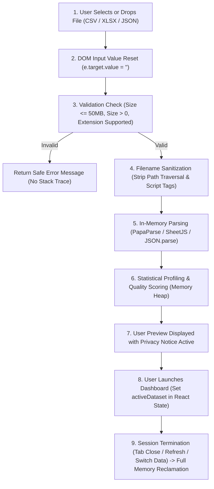

# PROJECT CONTEXT — OmniLens Platform

This document serves as the comprehensive architectural reference, implementation guide, and privacy specification for the OmniLens project.

---

## 1. Project Overview

### Application Purpose
OmniLens is a universal data intelligence platform designed to empower non-technical users, small business operators, students, and professionals to derive clear, evidence-backed insights from raw data files (CSV, Excel `.xlsx`/`.xls`, JSON) without writing code, formulas, or SQL queries. All findings are presented in accessible, conversational English inspired by a warm craft aesthetic.

### Existing Features
1. **Interactive File Ingest**: Drag-and-drop and file browser for CSV, Excel (`.xlsx`, `.xls`), and JSON.
2. **Immediate Dataset Profiling**: Instant calculation of row counts, detected column count, column data types, and data quality cleanliness score (0–100).
3. **6 Pre-loaded Sample Datasets**: Built-in demonstration datasets (Warm Brew Cafe, Personal Spending, Nordic Craft Co., Academy of Applied Sciences, City Works 311, Alpine Valley Observatory).
4. **Structured Evidence Cards**: "What Your Data Is Telling You" cards following a 6-part framework (observation, everyday explanation, calculated evidence, practical impact, suggested next steps, limitations).
5. **Interactive Visual Explorer**: Configurable Bar, Line, Donut, and Scatter charts with dynamic X/Y axis selection, metric aggregations, and paginated data tables.
6. **Data Quality & Cleanliness Audit**: Detection of missing values per column, duplicate row signatures, and statistical outliers via 1.5× Interquartile Range (IQR).
7. **Conversational Q&A Engine**: Grounded question-answering with natural language matching and inline chart generation.
8. **Multi-Format Export**: One-click generation of Executive PDF briefings, multi-sheet Excel workbooks, and normalized clean CSVs.

### Current Architecture
OmniLens is architected as an **in-browser, client-side Single Page Application (SPA)** built with React 18, Vite 6, and TypeScript. All statistical parsing, type inference, hygiene grading, natural language querying, and document rendering take place directly within the user's browser runtime memory. No remote backend server or persistent database is employed.

---

## 2. Frontend Context

### Framework and Dependencies
- **UI Framework**: React 18.3.1 with TypeScript 5.7.3.
- **Build Tool**: Vite 6.1.0 with `@vitejs/plugin-react`.
- **Styling**: Tailwind CSS 3.4.17 with PostCSS 8.5.2 and Autoprefixer 10.4.20.
- **Icons**: Lucide React (`lucide-react` 0.475.0).
- **Data Parsing**: `papaparse` 5.4.1 (CSV parsing/unparsing), `xlsx` 0.18.5 (Excel workbook binary parsing and multi-sheet generation).
- **Visualization**: `recharts` 2.15.1.
- **Reporting**: `jspdf` 2.5.2 and `jspdf-autotable` 3.8.4.
- **Utilities**: `clsx` 2.1.1, `tailwind-merge` 2.6.0.

### Directory and File Structure
```
Omni_Lense/
├── index.html                           # Single-page HTML entry point
├── package.json                         # Project dependencies and script declarations
├── package-lock.json                    # Exact dependency lockfile
├── postcss.config.js                    # PostCSS configuration for Tailwind
├── tailwind.config.js                   # Tailwind theme, colors, and typography settings
├── tsconfig.json                        # TypeScript compiler options
├── vite.config.ts                       # Vite bundler configuration
├── public/
│   └── logo.svg                         # Application brand vector asset
├── src/
│   ├── App.tsx                          # Root application component and view orchestrator
│   ├── index.css                        # Global CSS and Tailwind directives
│   ├── main.tsx                         # React DOM mount point
│   ├── types/
│   │   └── dataset.ts                   # Core data interfaces and types
│   ├── data/
│   │   └── sampleDatasets.ts            # 6 pre-loaded demonstration datasets
│   ├── components/
│   │   ├── Navbar.tsx                   # Top navigation bar
│   │   ├── LandingHero.tsx              # Landing page hero section
│   │   ├── HeroPreview.tsx              # Visual preview of analytics cards
│   │   ├── TrustSection.tsx             # Three core trust pillars
│   │   ├── UploadSection.tsx            # Drag & drop upload with Privacy Notice
│   │   ├── SampleDatasetsSection.tsx     # One-click sample dataset cards
│   │   ├── InteractiveFeatures.tsx      # Feature capabilities breakdown
│   │   ├── UseCaseSection.tsx           # Industry-specific user scenarios
│   │   ├── Footer.tsx                   # Global application footer
│   │   └── Dashboard/
│   │       ├── DashboardLayout.tsx      # Tab coordinator and sticky header
│   │       ├── OverviewTab.tsx          # Key metrics and summary cards
│   │       ├── FindingsTab.tsx          # 6-part evidence cards
│   │       ├── ExploreTab.tsx           # Dynamic charts and sortable table
│   │       ├── AskDataTab.tsx           # Conversational grounded data Q&A
│   │       ├── DataQualityTab.tsx       # Hygiene audit, outliers, deduplication
│   │       └── ReportsTab.tsx           # PDF, Excel, and CSV report export
│   └── utils/
│       ├── dataParser.ts                # File ingestion, validation, type inference
│       ├── dataAnalyzer.ts              # Quality score, IQR outliers, evidence cards
│       ├── qaEngine.ts                  # Local Q&A query engine
│       └── exportReports.ts             # PDF/Excel/CSV generation with URL revocation
└── tests/
    ├── engine.test.js                   # Analytical calculations and dataset integrity tests
    └── privacy.test.js                  # Privacy verification and constraint tests
```

### Main Pages and Components
- **`LandingHero`**: Introduces value proposition and primary action triggers.
- **`UploadSection`**: Primary file input component featuring drag-and-drop, format validation, format badges, file preview metrics, and the prominent Privacy Notice card.
- **`DashboardLayout`**: Manages the loaded dataset view across six operational tabs: `Overview`, `Explore`, `Findings`, `Ask Your Data`, `Data Quality`, and `Reports`.

### Existing Upload Interface
Located in `src/components/UploadSection.tsx`. It provides an interactive dropzone with dashed border accents, loading state spinners, format badges (CSV, Excel `.xlsx`/`.xls`, JSON), immediate file preview with record counts and data cleanliness, and sample dataset shortcuts.

### Upload-Related State Management
- `isDragging`: Boolean flag tracking hover state over the dropzone.
- `isLoading`: Boolean flag indicating in-progress parsing.
- `errorMessage`: String containing sanitized user-friendly error notices.
- `uploadedPreview`: Temporary `ParsedDataset` state holding the preview before the user clicks "Open Full Analytics Dashboard".
- `activeDataset` (in `App.tsx`): Active session dataset displayed in the dashboard.

### API Communication
OmniLens makes **zero API requests** for file uploading or processing. The file handling is completely local to the browser.

### Privacy Notice Implementation
Rendered inside `src/components/UploadSection.tsx` immediately below the supported format badges, ensuring it is visible before the user drops or selects a file:
- Positioned prominently with high-contrast text and a security shield icon.
- Displays the exact privacy commitment: files are processed temporarily in memory, never stored in a database, not made available for human browsing, and cleaned up after processing.

### Frontend Files Modified
1. `src/components/UploadSection.tsx`: Integrated the official Privacy Notice card and implemented DOM `<input>` element value resetting (`e.target.value = ''`).
2. `src/utils/dataParser.ts`: Implemented 50MB file size limit (`MAX_FILE_SIZE_BYTES`), 0-byte file detection, and filename sanitization (`sanitizeFileName`).
3. `src/utils/exportReports.ts`: Added `URL.revokeObjectURL(url)` to immediately free Blob memory upon CSV report download.

---

## 3. Backend Context

### Framework and Dependencies
OmniLens operates as a serverless, static-hosted frontend web application. There is **no Node.js/Express, Python/Django, or Java backend server** executing file uploads.

### Directory and File Structure
All execution logic resides within the `src/` directory. Static production builds are compiled into the `dist/` directory via `npm run build`.

### Application Entry Point
- Client: `src/main.tsx` and `index.html`.
- Production bundle: Served by any standard static web server or CDN (e.g., GitHub Pages, Netlify, Vercel).

### Routes and Controllers
Client-side view state (`currentView: 'home' | 'dashboard'`) controlled in `src/App.tsx`.

### File-Upload Endpoints
There are no HTTP file upload endpoints. Ingestion uses the browser's native `FileReader` and web streams.

### Processing and Parsing Logic
- `src/utils/dataParser.ts`:
  - `parseFile(file: File)`: Validates file existence, non-zero size, and <= 50MB limit; sanitizes filename; branches to PapaParse (CSV), SheetJS (XLSX/XLS), or native JSON parser.
  - `analyzeColumns(data)`: Scans records, infers data types (numeric, boolean, date, string) with a 70% threshold, calculates summaries, null counts, and category frequencies.
- `src/utils/dataAnalyzer.ts`:
  - `calculateQualityReport`: Calculates cleanliness score (10–100), duplicate row detection via JSON hashing, missing cell deductions, and IQR outliers.
  - `generateEvidenceFindings`: Generates evidence cards with verified arithmetic.

### Error Handling
Errors during parsing (unsupported extensions, malformed JSON, corrupted Excel sheets, empty files, size violations) are trapped in `try/catch` blocks and presented as friendly alert messages. Raw stack traces and file content fragments are never rendered to the user.

### Logging Behavior
Zero `console.log` or `console.error` calls are used to output dataset records or personal data. Operational execution runs cleanly without leaking data to developer tools or telemetry.

### Backend Files Modified
Not applicable (zero server-side backend files exist in this architecture).

---

## 4. Database Context

### Database Technology
**None**. OmniLens intentionally does not utilize any database system:
- No relational databases (PostgreSQL, MySQL, SQLite, etc.).
- No document/NoSQL stores (MongoDB, CouchDB, Firestore, etc.).
- No embedded key-value stores.
- No client-side browser databases (IndexedDB, WebSQL).
- No browser web storage (`localStorage`, `sessionStorage`).

### Relevant Models and Schemas
Data contracts exist purely as TypeScript interfaces in memory (`src/types/dataset.ts`):
- `ParsedDataset`: In-memory model representing active session data.
- `ColumnInfo`: Field schema, detected types, metrics.
- `DataQualityReport`: Hygiene calculations and anomaly summaries.
- `Finding`: Evidence discovery structured objects.

### Existing Database Operations
Zero read, write, update, or delete operations occur.

### How Uploaded File Persistence is Prevented
1. **No Storage Medium**: The application possesses no database connection or driver.
2. **Volatile Session Scope**: Datasets reside exclusively in React component state variables (`activeDataset`, `uploadedPreview`).
3. **No Storage API Invocations**: Codebase audits confirm zero calls to `localStorage.setItem`, `sessionStorage.setItem`, or `indexedDB.open`.
4. **DOM Handle Cleanup**: File input values are reset immediately upon selection.
5. **Session Discard**: Reloading or closing the browser tab permanently frees all allocated data memory from the JavaScript heap.

### Remaining Persistence Risks
- **Browser Memory Snapshots**: If an operating system creates swap/paging files under low RAM conditions, in-memory strings might temporarily touch virtual memory before OS memory management reclaims them.
- **Untrusted Browser Extensions**: Extensions with broad DOM or page inspection permissions could theoretically read state rendered in the DOM. Users are advised to run private/incognito mode when inspecting highly confidential information.

---

## 5. File-Processing Lifecycle

The complete lifecycle is adapted to the client-side architecture:



---

## 6. Privacy Architecture

| Dimension | Implementation Details |
| :--- | :--- |
| **Data Received** | File object directly from user's operating system via browser file picker / drag-and-drop. |
| **Temporary Data Handling** | File contents decoded into transient in-memory JavaScript objects (`Array<Record<string, any>>`). |
| **Database Persistence** | Strictly zero. No database libraries, connections, or write commands exist. |
| **Temporary File Cleanup** | No disk writes occur. File input elements are reset. Object URLs are revoked via `URL.revokeObjectURL(url)`. |
| **Logging Protections** | Zero logging of file contents, row records, headers, or PII. |
| **Caching & Queues** | No server caches, Redis instances, or background job queues. |
| **External Integrations** | No third-party AI APIs, analytics endpoints, tracking pixels, or cloud storage buckets. |
| **Size & DoS Protection** | Strict 50MB upper limit enforced before parsing to protect client machine stability. |

---

## 7. Configuration

### Required Environment Variables
OmniLens requires **zero environment variables** or secrets to build and run.

### Relevant Configuration Files
- `package.json`: Dependency specifications and NPM test/build scripts.
- `tsconfig.json`: TypeScript compiler options with strict type checking.
- `vite.config.ts`: Vite bundling and dev-server configuration.
- `tailwind.config.js`: Custom Starbucks-inspired color tokens (`forest`, `cream`, `warmWhite`, `mint`, `sage`, `charcoal`).

### Installation & Startup Commands
```bash
# 1. Clone the repository
git clone https://github.com/Janvithakre25/Omni_Lense.git
cd Omni_Lense

# 2. Install dependencies
npm install

# 3. Run local development server
npm run dev

# 4. Build production bundle
npm run build

# 5. Run automated test suite
npm test
```

> **Note on Terminal Sessions:** Because `npm run dev` remains running as a continuous foreground process, use a separate or different terminal window/tab to execute tests, builds, or git commands simultaneously.

---

## 8. Testing

### Test Suite Execution
Tests run via Node.js's native test runner (`node --test`):
```bash
npm test
```

### Verified Test Cases (12/12 Passing)
* **`tests/engine.test.js`**:
  1. `detectColumnType`: Identifies numeric, string, and date types accurately.
  2. `IQR Outlier calculation`: Accurately flags extreme values using 1.5× IQR fences.
  3. `Quality score`: Properly assesses completeness and duplicate penalties.
  4. `Sample datasets integrity`: Validates all 6 embedded demonstration datasets.
  5. `Plain English requirement`: Asserts absence of academic/technical jargon in user text.
* **`tests/privacy.test.js`**:
  6. `sanitizeFileName`: Eliminates directory traversal (`../../etc/passwd`, `..\..\cmd.csv`) and script tags.
  7. `File size enforcement`: Validates 50MB maximum and 0-byte file rejection.
  8. `No database dependencies`: Asserts zero database drivers or ORMs in `package.json`.
  9. `No external network calls`: Verifies zero `fetch()`, `axios`, or `XMLHttpRequest` calls in processing modules.
  10. `No browser storage persistence`: Verifies zero `localStorage`, `sessionStorage`, or `indexedDB` writes.
  11. `Privacy notice integrity`: Validates exact verbatim compliance with required privacy notice wording in `UploadSection.tsx`.
  12. `exportReports object URL revocation`: Verifies that `URL.revokeObjectURL(url)` is called to prevent memory leaks.

---

## 9. Modification History

| File Modified / Created | Reason for Modification |
| :--- | :--- |
| `src/components/UploadSection.tsx` | Added the required Privacy Notice card adjacent to the upload dropzone; added DOM input value reset to prevent lingering File references. |
| `src/utils/dataParser.ts` | Added `MAX_FILE_SIZE_BYTES` (50MB) validation, 0-byte file protection, and `sanitizeFileName` to eliminate path traversal vulnerabilities. |
| `src/utils/exportReports.ts` | Added `URL.revokeObjectURL(url)` after CSV generation to guarantee memory release. |
| `package.json` | Updated `"test"` script to execute both `engine.test.js` and `privacy.test.js`. |
| `tests/privacy.test.js` | Created dedicated automated privacy and security test suite (7 automated tests). |
| `README.md` | Updated with comprehensive Privacy & Security Architecture, how files are handled, and test verification procedures. |
| `PROJECT_CONTEXT.md` | Created the foundational architectural and privacy reference documentation for the project. |

---

## 10. Instructions for Future AI Coding Agents

When working on this repository, you must adhere to the following non-negotiable guidelines:

1. **Read `PROJECT_CONTEXT.md` and `README.md` First**: Understand the client-side architecture before making any modifications.
2. **Preserve Current Architecture**: Do not add server backends, remote databases, or cloud processing unless explicitly requested by the user.
3. **Preserve the Frontend Design**: Do not redesign or alter the Starbucks-inspired palette (`forest`, `cream`, `warmWhite`, `sage`, `mint`, `charcoal`), typography, or existing tab layouts.
4. **Never Introduce Persistent File Storage**: Uploaded files and their extracted contents must never be written to a database, external server, `localStorage`, `sessionStorage`, or `indexedDB`.
5. **Maintain Privacy Notice Integrity**: The privacy notice in `UploadSection.tsx` must remain clearly visible, accessible, and truthful.
6. **Protect Against Memory Retention**: Ensure all file inputs, readers, and object URLs are cleaned up or revoked promptly.
7. **Maintain Test Coverage**: Always run `npm test` after modifying analytical or file-handling logic and ensure all tests pass.
8. **Never Make Unverified Privacy Claims**: Only assert guarantees that are substantiated by codebase verification and test execution.
